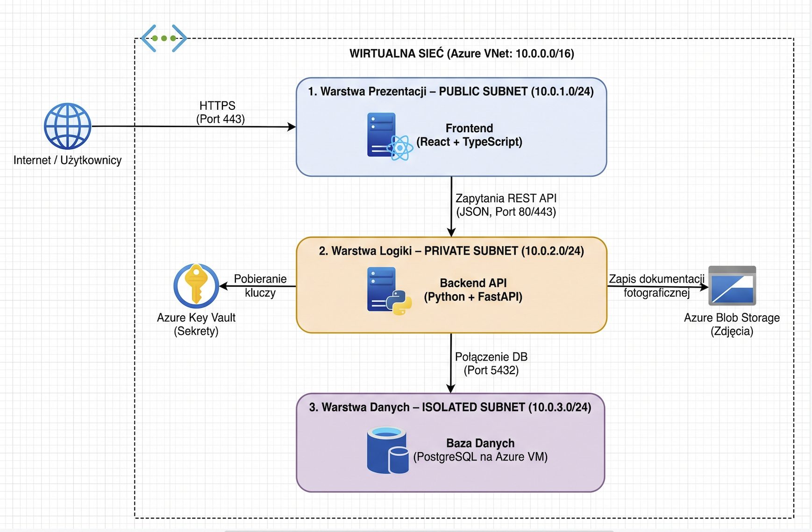

GearPass - Bezpieczna wypożyczalnia sprzętu

GearPass to aplikacja chmurowa do rezerwacji i wypożyczania sprzętu (takiego jak aparaty, zestawy VR, konsole i mikrofony) w ramach jednej organizacji.Projekt umożliwia przeglądanie katalogu i dostępności, zarządzanie sprzętem i rezerwacjami oraz obsługę wydań i zwrotów z dokumentacją fotograficzną stanu urządzeń. Obejmuje logowanie, role użytkownika i opiekuna, kontrolę dostępu do danych, jednorazowe kody QR do potwierdzania odbioru oraz historię operacji.

Zespół "Grupa Specjalna"

(Podział ról)

Rola Imię i Nazwisko Numer studenta

PM (Project Manager) Adam Pajer 96736

DevOps Krzysztof Wojtkowiak 94750

Frontend Developer Krzysztof Wojtkowiak 94750

Backend Developer Krzysztof Wojtkowiak 94750 

DBA (Database Admin)Krzysztof Wojtkowiak 94750

## Architektura

Publiczne demo używa Azure App Service F1. Azure kończy TLS i przekierowuje HTTP do HTTPS. Frontend React i API FastAPI działają na wspólnym hoście. Endpointy katalogu zwracają dane demonstracyjne. Demo nie ma połączenia z wdrożoną bazą PostgreSQL.

Publiczne demo: https://gearpass-blok08-bcetfjepebbef8hq.swedencentral-01.azurewebsites.net/

Schemat docelowej architektury trójwarstwowej:

## Reguły sieciowe (blok 09)

[Szablon sieci w Azure](config/azure/hardening-network.bicep) definiuje `vnet-gearpass` oraz NSG przypisane do trzech podsieci. Reguły w tabeli dotyczą tych podsieci. Publiczne demo na F1 działa poza tą siecią. Do potwierdzenia pełnej izolacji trzeba uruchomić oddzielne warstwy Web, App i Data w sieci i sprawdzić ruch między nimi.

| Warstwa / podsieć | Kierunek | Źródło → cel | TCP | Decyzja |
| --- | --- | --- | --- | --- |
| Web · `snet-web` | Inbound | Internet → Web | 80, 443 | Zezwól |
| Web · `snet-web` | Outbound | Web → App | 8000 | Zezwól |
| App · `snet-app` | Inbound | Web → App | 8000 | Zezwól |
| App · `snet-app` | Inbound | Internet → App | 22, 3389 | Blokuj |
| App · `snet-app` | Outbound | App → Data | 5432 | Zezwól |
| Data · `snet-data` | Inbound | App → Data | 5432 | Zezwól |
| Data · `snet-data` | Inbound | Internet → Data | 3306, 5432 | Blokuj |
| Web, App i Data | Inbound / Outbound | Pozostały ruch inicjowany | Wszystkie | Blokuj |

Tag `Internet` oznacza ruch z publicznego Internetu. Priorytety zezwoleń i blokad szczegółowych to 100 i 110. Reguły blokujące pozostały ruch mają priorytet 4096 i wyprzedzają domyślne reguły NSG. NSG są stanowe, więc odpowiedzi na dozwolone połączenia nie wymagają osobnych reguł.

W publicznym App Service włączone jest `HTTPS Only`, a minimalna wersja TLS dla witryny i SCM to 1.2. FTPS i debugowanie zdalne są wyłączone. Wdrożenie ZIP korzysta z tożsamości OIDC GitHub Actions.

## Dokumentacja API
| Metoda | Endpoint | Opis |
| :--- | :--- | :--- |
| GET | `/api/equipment` | Pobranie pełnej listy zasobów |
| POST | `/api/equipment` | Utworzenie nowego zasobu z walidacją |

## Instrukcja Uruchomienia Lokalnego
**Backend:** `cd backend` -> `uvicorn main:app --reload`
**Frontend:** `cd frontend` -> `npm install` -> `npm run dev`
