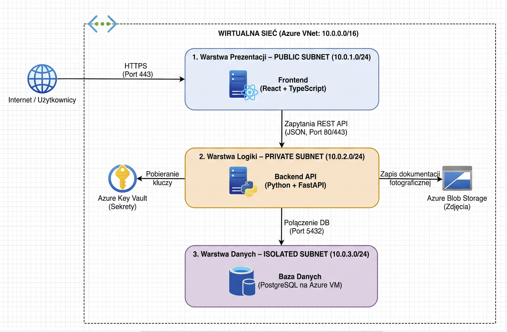

GearPass - Bezpieczna wypożyczalnia sprzętu

GearPass to aplikacja chmurowa do rezerwacji i wypożyczania sprzętu (takiego jak aparaty, zestawy VR, konsole i mikrofony) w ramach jednej organizacji.Projekt umożliwia przeglądanie katalogu i dostępności, zarządzanie sprzętem i rezerwacjami oraz obsługę wydań i zwrotów z dokumentacją fotograficzną stanu urządzeń. Obejmuje logowanie, role użytkownika i opiekuna, kontrolę dostępu do danych, jednorazowe kody QR do potwierdzania odbioru oraz historię operacji.

Zespół "Grupa Specjalna"

(Podział ról)

Rola Imię i Nazwisko Numer studenta

PM (Project Manager) Adam Pajer 96736

DevOps Krzysztof Wojtkowiak 94750

Frontend Developer Krzysztof Wojtkowiak 94750

Backend Developer Krzysztof Wojtkowiak 94750 

DBA (Database Admin)Krzysztof Wojtkowiak 94750

 Architektura i Stos Technologiczny 
 
 Projekt oparty jest o Architekturę 3-tier, z podziałem na warstwy znajdujące się w osobnych podsieciach: Warstwa prezentacji (Web): Publiczna.Warstwa logiki (API): Prywatna (bez publicznego IP).
 Warstwa danych (Baza danych): Izolowana.Technologie:Front-end: React + TypeScriptBack-end: Python + FastAPI, REST API, SQLAlchemyBaza danych:  PostgreSQL (prywatna maszyna wirtualna)Chmura: Microsoft Azure (Virtual Machines, Virtual Network, Blob Storage, Key Vault)Wdrożenie i CI/CD: Docker, GitHub Actions, Bicep Struktura Repozytorium/frontend - Kod źródłowy aplikacji klienckiej (React)./backend - Kod źródłowy serwera API (FastAPI)./config - Pliki konfiguracyjne, infrastruktura jako kod (IaC - Bicep) oraz konfiguracje wdrożeniowe./docs - Dokumentacja projektu, w tym schematy architektury systemu (diagramy przepływu danych).

 

 Powyższy schemat przedstawia architekturę trójwarstwową wdrożoną w obrębie sieci wirtualnej Azure VNet. System został podzielony na trzy odseparowane podsieci, aby zapewnić maksymalne bezpieczeństwo:  
 
 Warstwa Prezentacji (Public Subnet): Zawiera aplikację frontendową w React + TypeScript. Jako jedyna posiada dostęp z Internetu za pomocą protokołu HTTPS przez port 443.   
 
 Warstwa Logiki (Private Subnet): Zawiera Backend API stworzony w technologiach Python i FastAPI. Odbiera zapytania REST API od warstwy prezentacji i łączy się z usługą Azure Key Vault w celu bezpiecznego pobierania kluczy. Odpowiada również za zapis dokumentacji fotograficznej w usłudze Azure Blob Storage.  
 
 Warstwa Danych (Isolated Subnet): Jest to całkowicie wyizolowana podsieć zawierająca bazę danych PostgreSQL na Azure VM. Komunikuje się wyłącznie z warstwą logiki poprzez połączenie na porcie 5432, co chroni dane przed nieautoryzowanym dostępem.
